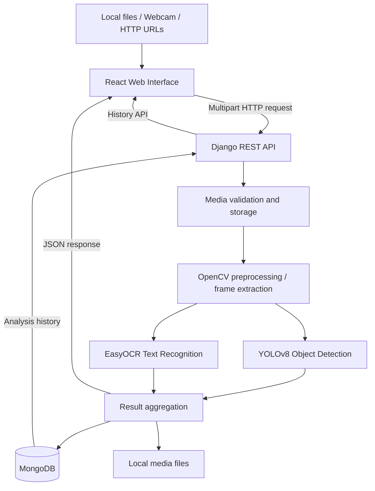

<div align="center">
  

  <h1>RetailLens AI</h1>
  <p><strong>Computer Vision &amp; Multilingual OCR for Retail Analytics</strong></p>
  <p>From retail images and videos to structured, searchable visual insights.</p>
  <p><strong>Summer Internship Project · VisShopAI · 2025</strong></p>
  <p>
    
    
    
    
    
    
    
    
  </p>
  <p>
    <a href="#overview">Overview</a> ·
    <a href="#capabilities">Capabilities</a> ·
    <a href="#architecture">Architecture</a> ·
    <a href="#getting-started">Getting Started</a> ·
    <a href="#rest-api">API</a>
  </p>
</div>

---

## Overview

**RetailLens AI** is a full-stack computer vision application originally developed during my **2025 summer internship at VisShopAI**. It brings together object detection, multilingual optical character recognition (OCR), and image/video processing in a single web interface for retail visual analysis.

The application uses a custom **YOLOv8** checkpoint to identify object categories, **EasyOCR** to extract visible text in English and Arabic, and **OpenCV** to preprocess images and sample video frames. A Django REST API coordinates inference, while MongoDB stores structured analysis records and React provides an interactive interface for reviewing results.

This repository contains the internship project and subsequent improvements to its architecture, configuration, validation, tests, and documentation.

<div align="center">
  
  <p><em>Retail environment — illustrative input, not an application screenshot or model prediction.</em></p>
  <sub>Photo: <a href="https://commons.wikimedia.org/wiki/File:Supermarket_shelves.jpg">Supermarket shelves</a> by Frankie Fouganthin, <a href="https://creativecommons.org/licenses/by-sa/4.0/">CC BY-SA 4.0</a> (displayed at reduced size).</sub>
</div>

## Capabilities

| Capability | Description |
| --- | --- |
| **Object detection** | Identify object categories with the bundled YOLOv8 checkpoint and visualize detections on images. |
| **Multilingual OCR** | Extract English and Arabic text while preserving numbers, brand names and prices during normalization. |
| **Image acquisition** | Analyze local image files, webcam snapshots and accessible HTTP(S) image URLs. |
| **Video analysis** | Process uploaded videos, webcam recordings and accessible downloadable video URLs. |
| **Frame sampling** | Extract approximately one frame per second, capped at 120 frames per request. |
| **Visual results** | Review annotated images with detection boxes and OCR polygons, or inspect video-frame results. |
| **Analysis history** | Store results in MongoDB and retrieve the 50 most recent records for each media type. |

## Architecture



### Processing pipeline

1. **Acquisition:** the user uploads an image/video or captures media through the webcam.
2. **Validation:** the backend checks the upload format and size before saving it.
3. **Preprocessing:** OpenCV prepares images and extracts frames from recorded videos.
4. **Inference:** YOLOv8 detects objects and EasyOCR extracts visible text. Models are loaded lazily and reused within each backend process.
5. **Persistence:** MongoDB stores structured results; original and generated media remain on the local filesystem.
6. **Presentation:** React displays the analysis and provides access to the history page.

## Technology stack

| Layer | Technologies | Responsibility |
| --- | --- | --- |
| Frontend | React, React Router, Tailwind CSS, React Webcam | Media acquisition, visualization, history |
| Backend | Python, Django, Django REST Framework | HTTP API, orchestration, validation |
| Computer vision | Ultralytics YOLOv8, OpenCV | Object detection and media processing |
| Text recognition | EasyOCR | English and Arabic OCR |
| Data layer | MongoDB, PyMongo | Structured analysis records |
| Internal Django storage | SQLite | Built-in Django tables |

## Repository structure

```text
RetailLens-AI/
├── public/                     # Web application entry point
├── src/
│   ├── assets/                 # Existing visual assets
│   ├── components/             # Media input and analysis UI
│   ├── pages/                  # Analysis history
│   ├── api.js                  # Shared HTTP client
│   └── backend/
│       ├── backend/            # Django settings and routing
│       ├── vision/
│       │   ├── best.pt         # Bundled YOLO checkpoint
│       │   ├── inference.py    # Shared AI models
│       │   ├── services.py     # Image and video analysis
│       │   ├── database.py     # MongoDB access
│       │   ├── storage.py      # Media storage
│       │   ├── utils/          # OCR normalization
│       │   ├── video_utils/    # Frame extraction and inference
│       │   ├── views.py        # REST endpoints
│       │   └── tests.py        # Backend tests
│       ├── requirements.txt
│       ├── .env.example
│       └── manage.py
├── experiments/               # Legacy PaddleOCR experiment
├── .env.example
├── package.json
└── README.md
```

## Getting started

### Prerequisites

- Python 3.11 or 3.12 recommended
- Node.js 20 or 22 and npm
- A running MongoDB instance (or Docker for local setup)
- Internet access for the initial EasyOCR model download

The commands below use **Windows PowerShell**.

### 1. Clone the repository

```powershell
git clone https://github.com/medaminesalhi/RetailLens-AI.git
cd RetailLens-AI
```

### 2. Start MongoDB

Use an existing MongoDB service, or start a local development container:

```powershell
docker run -d --name retaillens-mongo -p 127.0.0.1:27017:27017 -v retaillens-mongo-data:/data/db mongo:7
```

Skip this command if MongoDB is already running. This Docker configuration is for local development only.

### 3. Configure and run the backend

From the repository root:

```powershell
python -m venv .venv
.\.venv\Scripts\Activate.ps1
python -m pip install -r src/backend/requirements.txt
Copy-Item src/backend/.env.example src/backend/.env
python -c "import secrets; print(secrets.token_urlsafe(50))"
```

Add the generated secret to `DJANGO_SECRET_KEY` in `src/backend/.env`. Set `MONGO_URI` if your MongoDB instance is not local. Never commit `.env` files. Only load the bundled model checkpoint if you trust its origin, as PyTorch checkpoints may contain executable serialized content.

```powershell
cd src/backend
python manage.py migrate
python manage.py check
python manage.py runserver
```

Backend: <http://localhost:8000>

CPU inference is the default. GPU inference requires a compatible runtime and appropriate `YOLO_DEVICE` / `OCR_GPU` settings.

### 4. Run the frontend

Open a second terminal at the repository root:

```powershell
Copy-Item .env.example .env
npm ci
npm start
```

| Service | Local URL |
| --- | --- |
| Web application | <http://localhost:3000> |
| Analysis history | <http://localhost:3000/historique> |
| Django API | <http://localhost:8000/api/> |

## REST API

| Method | Endpoint | Purpose |
| --- | --- | --- |
| `POST` | `/api/process-image/` | Upload an `image` and optionally specify `source`; return detections and OCR. |
| `POST` | `/api/process-video/` | Upload a `video`; return sampled-frame analysis and truncation status. |
| `GET` | `/api/history-images/` | Retrieve recent image analysis records. |
| `GET` | `/api/history-videos/` | Retrieve recent video analysis records. |

### Example image analysis

```powershell
curl.exe -X POST -F "image=@sample.jpg" -F "source=local" http://localhost:8000/api/process-image/
```

Illustrative response structure (not measured inference output):

```json
{
  "image_path": "/media/images/example_annotated.jpg",
  "categories": ["example_category"],
  "ocr_text": ["Promo 20%", "حليب"]
}
```

Supported images: JPEG, PNG and WebP (up to 10 MiB). Supported video extensions: MP4, WebM, AVI, MOV and MKV (up to 100 MiB), subject to installed codecs. URL imports require browser access and appropriate CORS headers. Continuous IP-camera streams are not supported.

## Testing and validation

Backend tests cover OCR normalization, missing/invalid uploads and a mocked history response. They do not require live MongoDB or run AI inference.

```powershell
cd src/backend
python manage.py test vision
```

From the repository root:

```powershell
npm test -- --watchAll=false
npm run build
```

For end-to-end validation, upload a sample image and a short video, inspect their results, and confirm that both appear in the history interface.

## Project status & roadmap

This project is a development prototype. The supplied repository includes a model checkpoint but does not include the training dataset, training configuration, class documentation or measured accuracy metrics. The API processes requests synchronously and does not yet implement application-level access controls or media retention policies. It should not be exposed publicly as-is.

Planned engineering improvements:

- [ ] Document the training dataset, model classes and evaluation metrics (precision, recall, mAP).
- [ ] Containerize the application with Docker Compose.
- [ ] Add automated CI checks with GitHub Actions.
- [ ] Move long-running video inference to background jobs.
- [ ] Add authentication, media retention and stronger upload security.
- [ ] Benchmark CPU and GPU inference performance.

## Internship & author

<table>
  <tr>
    <td width="150" align="center"></td>
    <td>
      <strong>VisShopAI — Summer Internship, 2025</strong><br />
      Applied AI &amp; Computer Vision for Retail<br />
      Original internship project, with subsequent repository improvements.
    </td>
  </tr>
</table>

**Med Amine Salhi** — Engineering student in Data Engineering

[](https://github.com/medaminesalhi)

The VisShopAI logo is included as internship context and does not imply company endorsement of subsequent repository changes. Confirm permission to publish company-related assets and code before public distribution.

---

<div align="center">
  <sub>RetailLens AI · Applied Computer Vision · Summer Internship 2025</sub>
</div>
