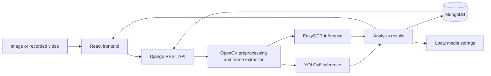

# RetailLens AI

**Computer vision and multilingual OCR for retail visual analytics.**

RetailLens AI is a full-stack application that analyzes retail images and recorded videos. It combines a custom YOLOv8 checkpoint with EasyOCR and OpenCV to extract object categories and visible text, then stores analysis results in MongoDB for later review through a React interface.

## Features

- Image analysis from local files, webcam snapshots or accessible HTTP(S) image URLs.
- Recorded video analysis from local files, webcam recordings or downloadable HTTP(S) video files.
- Object category detection using the bundled `best.pt` checkpoint.
- English and Arabic OCR with whitespace normalization and duplicate removal, preserving prices and brand names.
- Annotated images with YOLO detections and OCR bounding polygons.
- Video sampling at approximately one frame per second, with a maximum of 120 sampled frames per request.
- Persistent analysis history, including the 50 most recent image and video records per endpoint.

## Architecture



The API processes uploads synchronously. Models are loaded lazily and reused within each backend process. MongoDB stores structured analysis records; media files remain on the local filesystem. Django's built-in admin and authentication tables use SQLite.

## Technology stack

| Layer | Technologies |
| --- | --- |
| Frontend | React, React Router, Tailwind CSS, React Webcam |
| Backend | Python, Django, Django REST Framework |
| Object detection | Ultralytics YOLOv8 |
| OCR | EasyOCR (English and Arabic) |
| Image and video processing | OpenCV |
| Persistence | MongoDB, PyMongo, SQLite (Django internal tables) |

## Repository structure

```text
retaillens-ai/
├── public/                      # Web application entry point
├── src/
│   ├── api.js                   # Shared HTTP client
│   ├── components/              # Upload, webcam and result UI
│   ├── pages/                   # Analysis history
│   └── backend/
│       ├── backend/             # Django configuration
│       ├── vision/
│       │   ├── best.pt          # Bundled detection checkpoint
│       │   ├── database.py      # MongoDB access
│       │   ├── inference.py     # Shared model loading and inference
│       │   ├── services.py      # Image and video analysis
│       │   ├── storage.py       # Media storage helpers
│       │   ├── utils/           # OCR normalization
│       │   ├── video_utils/     # Frame extraction and inference helpers
│       │   ├── views.py         # API endpoints
│       │   └── tests.py         # Backend tests
│       ├── manage.py
│       ├── requirements.txt
│       └── .env.example
├── experiments/                # Legacy PaddleOCR experiment (not part of API)
├── .env.example                 # Frontend API configuration
├── package.json
└── README.md
```

## Getting started

### Prerequisites

- Python 3.11 or 3.12 recommended.
- Node.js 20 or 22 and npm.
- A running MongoDB instance, local or remote.
- Internet access on the first EasyOCR initialization to download model files.

The instructions below use Windows PowerShell and assume the terminal is at the repository root. Only load the bundled checkpoint if you trust its origin; PyTorch model checkpoints can contain executable serialized content.

### 1. Start MongoDB

Use an existing local MongoDB service, or start a development container if Docker is installed:

```powershell
docker run -d --name retaillens-mongo -p 127.0.0.1:27017:27017 -v retaillens-mongo-data:/data/db mongo:7
```

Skip this command if MongoDB is already available. The container configuration is intended for local development only.

### 2. Configure the backend

```powershell
python -m venv .venv
.\.venv\Scripts\Activate.ps1
pip install -r src/backend/requirements.txt
Copy-Item src/backend/.env.example src/backend/.env
python -c "import secrets; print(secrets.token_urlsafe(50))"
```

Copy the generated secret into `DJANGO_SECRET_KEY` in `src/backend/.env`. Do not commit the `.env` file. Adjust `MONGO_URI` if using another MongoDB server.

```powershell
cd src/backend
python manage.py migrate
python manage.py check
python manage.py runserver
```

The backend runs at `http://localhost:8000`. CPU inference is the default; configure `YOLO_DEVICE` and `OCR_GPU` only if a compatible GPU runtime is installed.

### 3. Start the frontend

Open another terminal at the repository root:

```powershell
Copy-Item .env.example .env
npm ci
npm start
```

Open `http://localhost:3000`. The analysis history is available at `/historique`.

## REST API

| Method | Endpoint | Input / output |
| --- | --- | --- |
| POST | `/api/process-image/` | Multipart `image`, optional `source`; annotated image, categories, OCR text |
| POST | `/api/process-video/` | Multipart `video`; video URL, sampled frames and truncation flag |
| GET | `/api/history-images/` | Latest image records |
| GET | `/api/history-videos/` | Latest video records |

Example image request (replace `sample.jpg` with a real image):

```powershell
curl.exe -X POST -F "image=@sample.jpg" -F "source=local" http://localhost:8000/api/process-image/
```

Illustrative response (not a measured model result):

```json
{
  "image_path": "/media/images/example_annotated.jpg",
  "categories": ["example_category"],
  "ocr_text": ["Promo 20%", "حليب"]
}
```

Supported image uploads: JPEG, PNG, WebP, up to 10 MiB. Video extensions: MP4, WebM, AVI, MOV and MKV, up to 100 MiB; decoding also depends on the OpenCV codecs installed. URL imports require browser access and appropriate CORS headers. Continuous IP-camera streams are not supported by this implementation.

## Testing

Backend tests cover OCR normalization, invalid/missing uploads and a mocked history response, without running model inference or requiring MongoDB.

```powershell
cd src/backend
python manage.py test vision
```

From the repository root, run the React smoke test and production build:

```powershell
npm test -- --watchAll=false
npm run build
```

For end-to-end validation, upload a sample image and a short video, inspect the output, and verify that both records appear on the history page.

## Limitations and roadmap

This repository is a development prototype, not a production-ready service. The supplied snapshot does not include the training dataset, training configuration, class documentation or measured model accuracy. Inference quality must be evaluated on representative retail data. OCR is configured for English and Arabic, not explicitly for French. Processing is synchronous and the API has no application-level access controls or retention policy. Do not expose it publicly as-is.

Potential next steps include documenting the training pipeline and metrics, automated CI, background video jobs, authentication, upload hardening, media retention, containerized deployment and GPU benchmarking.

## Author

Med Amine Salhi
